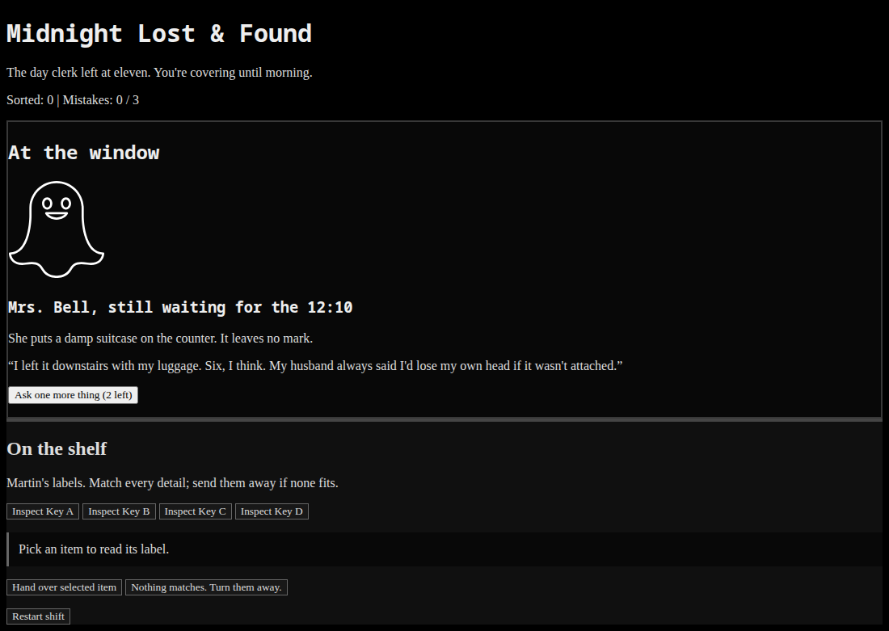
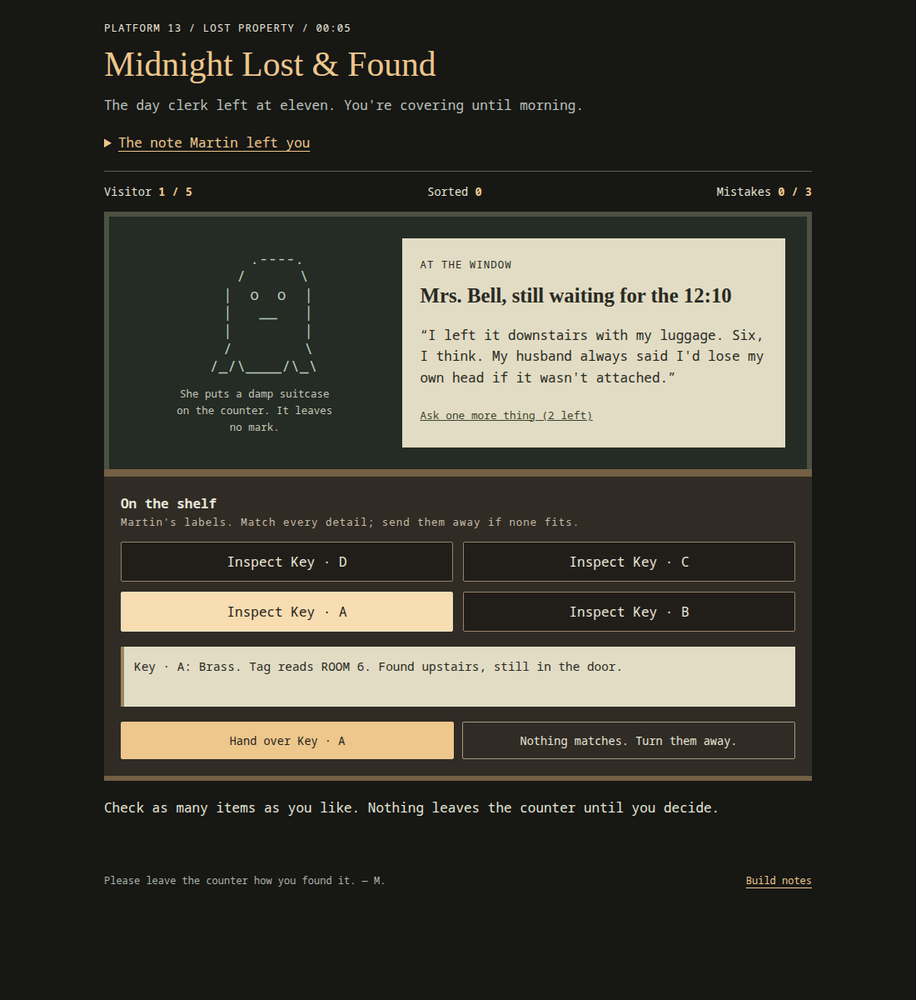
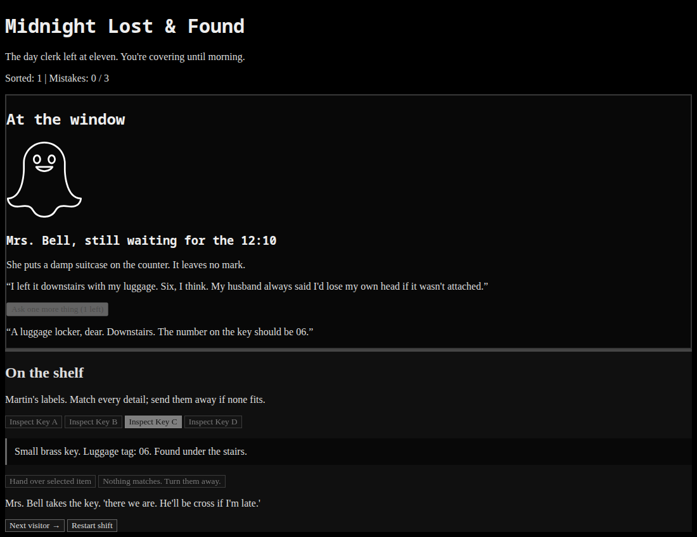
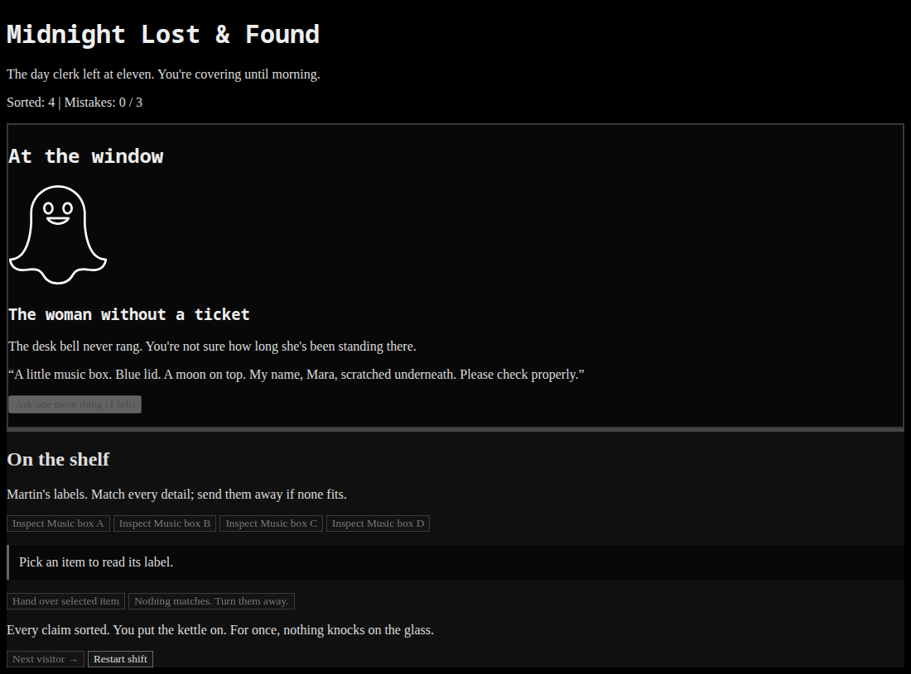

# Midnight Lost & Found

A small spooky browser game about working the night shift at a station's lost-property window. The day clerk has gone home, and four ghostly visitors need help finding their belongings. Read their stories, inspect the items on the shelf, and decide what to hand over. If nothing matches, turn the visitor away.

**[Play the game](https://hushroot.github.io/midnight-lost-and-found/)**



*Your first visitor is Mrs. Bell. Her story appears in “At the window,” and the four items you can inspect are under “On the shelf.” Sorted claims and mistakes appear at the top.*

## Why I made it

I was inspired by the black theme and the way 3am projects are designed. That gave me a starting point for a spooky game: an ordinary lost-property desk where the visitors are ghosts. The dark background, ghost illustration, and strange conversations all fit that idea.

## How to play

1. Read the visitor's description and claim. Pay attention to details such as a number, color, time, or name.
2. Click an **Inspect** button to read that item's label. The selected button is highlighted. You can inspect all four items without changing your score or committing an answer.
3. If you need help, click **Ask one more thing** for an extra clue. You have two questions for the entire shift, with at most one per visitor.
4. Select the item that matches every detail, then click **Hand over selected item**. If none matches, click **Nothing matches. Turn them away.**
5. Read the visitor's response or the explanation of your mistake, then click **Next visitor →**. After the final claim or your third mistake, this same button reveals the ending.



*Inspecting an item only selects it and shows its label. Compare the label with the claim before deciding whether to return it.*

| Button | What it does |
| --- | --- |
| Inspect Key / Lamp / Watch / Music box A–D | Selects an item and displays its label. Click another to compare. |
| Ask one more thing | Shows an extra clue and uses one of your two questions. |
| Hand over selected item | Submits your selected item. If you haven't selected anything, it asks you to choose first. |
| Nothing matches. Turn them away. | Submits a rejection. This is correct when none of the four labels matches the whole claim. |
| Next visitor → | Continues after your decision, or shows the ending when the shift is over. |
| Restart shift | Starts again at any time, resetting the score, mistakes, and questions. |

You can also use **Tab** to move between buttons and **Enter** to activate the focused button.



*Here, a follow-up question has been used and a matching item returned. The visitor responds, the score updates, and the answer buttons lock until you continue.*

## Scoring and endings

A correct return or rejection adds one to **Sorted**. A wrong decision adds one mistake. There are four visitors, and three mistakes close the window early. Finish all four claims without mistakes for the best ending, or reach morning with one or two mistakes for a different ending.



*The ending appears below the shelf on the same page. This screenshot shows the result of sorting all four claims correctly. Use “Restart shift” to play again.*

The visitors and item positions stay in a fixed order. There is no timer, and progress is not saved: refreshing the page or restarting begins a fresh shift. The screenshots reveal parts of the first puzzle and one ending.

## What was challenging

The hardest part for me was the JavaScript. It has to keep track of the current visitor, selected item, score, mistakes, and remaining questions. Those values also control which buttons are available and when the shift ends. Keeping inspection separate from submitting an answer is an important part of that logic.

## Run locally

Download the repository and open `index.html` in a browser with JavaScript enabled. No packages or build step are needed.

You can also run this command from the project folder:

```sh
python3 -m http.server 8013 --bind 127.0.0.1
```

Then open [http://127.0.0.1:8013](http://127.0.0.1:8013).

Built with HTML, CSS, and plain JavaScript. `index.html` contains the page, `style.css` provides the dark theme, `script.js` contains the visitors and game logic, and `assets/ghost.svg` is the ghost illustration. README screenshots are stored in `docs/screenshots/`.
