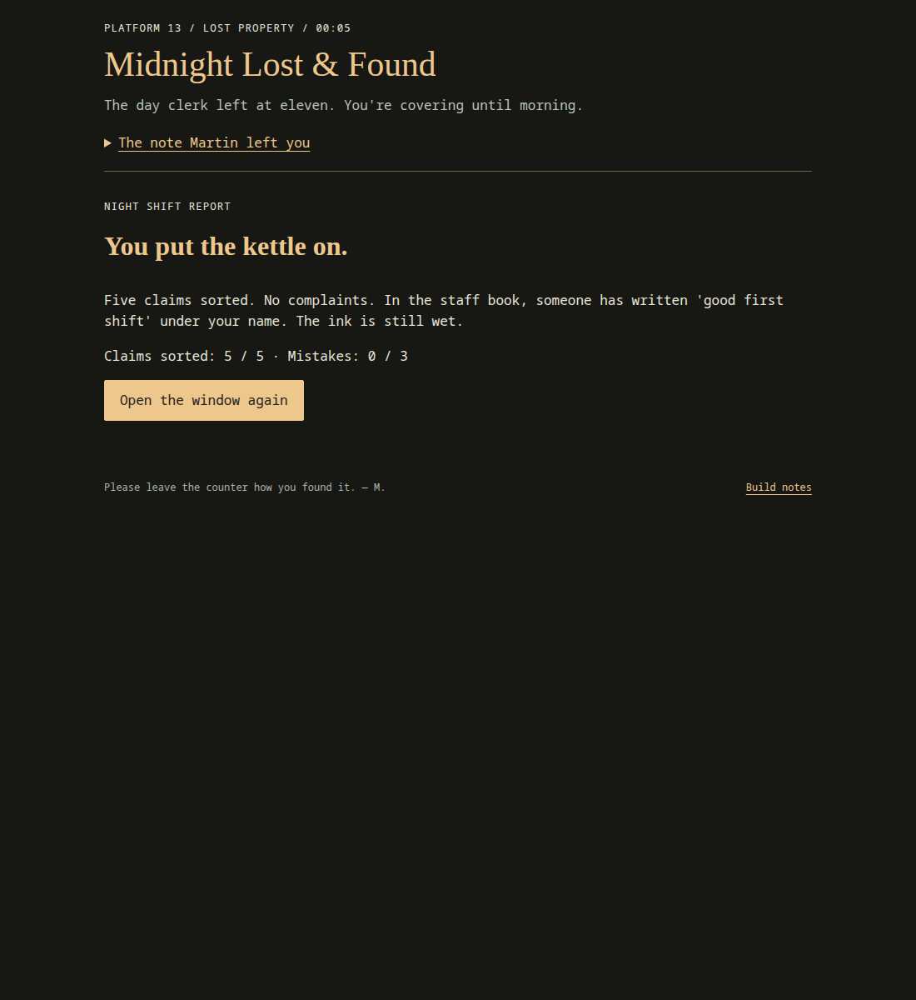

# Midnight Lost & Found

A small spooky browser game about working the night window at Platform 13. The day clerk has gone home, five ghosts are looking for their belongings, and you're the person checking the labels.

Each visitor gives you a claim and four similar items to inspect. Match every detail before returning anything. Sometimes none of the items belongs to the visitor, so turning them away is the right decision. The unease comes from the conversations and small details: a damp suitcase that leaves no mark, a train that stopped running years ago, and a visitor who never rang the bell.

*The night window: the visitor's claim is beside the ghost, the belongings are below it, and the shift log tracks sorted claims and mistakes.*

## Try it

Open `index.html` in a browser. No installation or build is needed. Alternatively, run `python3 -m http.server 8013 --bind 127.0.0.1` from this folder and visit `http://127.0.0.1:8013`.

JavaScript must be enabled. There are no packages to install, no build step, and no account needed.

## How to play

1. Open **The note Martin left you** for the clerk's instructions, then read the visitor's claim.
2. Press **Inspect** on an item to read its label. Compare its details with the claim. You can inspect all four items without spending a question, changing your score, or submitting an answer.
3. If you're stuck, press **Ask one more thing**. You have two questions for the whole shift, with at most one per visitor. The original clues are enough to solve every claim without asking.
4. Press **Hand over…** when you've selected a matching item. If none fits every detail, press **Nothing matches. Turn them away.** Either action commits your decision; you can't change it for that visitor.
5. Read the response, then press **Ring for the next visitor →**. After the last visitor or your third mistake, press **Close up for the night →** to see your report.

*Inspection shows the item's label and enables its hand-over button. Selecting an item is separate from returning it, so you can compare labels before deciding.*

| Control | When to use it |
| --- | --- |
| Inspect… | Read a label and select that item; use another Inspect button to change your selection. |
| Ask one more thing | Get an extra clue before deciding, while you still have questions left. |
| Hand over… | Submit the currently selected item. Disabled until you inspect something. |
| Nothing matches. Turn them away. | Submit a rejection when no label matches the whole claim. |
| Ring for the next visitor → / Close up for the night → | Continue after reading the result of your decision. |
| Open the window again | Restart from the ending screen with zero score, zero mistakes, and two questions. |

Use a mouse or touch, or press **Tab** to move between controls and **Enter** to activate the focused control. There are no separate keyboard shortcuts.

*After a decision, the game updates the shift log and shows the visitor's reaction or an explanation of the mistake. The controls lock until you continue.*

## Finishing the shift

A correct return or a correct rejection adds one sorted claim. A wrong return or rejection adds one mistake. Sort all five claims without a mistake for the best ending, finish with one or two mistakes for another ending, or make three mistakes to close the window early.

*The shift report shows your final totals. “Open the window again” starts a fresh shift. Screenshots show parts of the opening puzzle and one ending.*

There is no timer, audio, or flashing effect. Visitor order stays fixed, but shelf positions shuffle each visit, so compare labels rather than memorizing positions. Progress is not saved: reloading the page or restarting begins again.

## The idea and inspiration

The idea behind this project was to turn an ordinary lost-property desk into a small ghost story. Returning a key or an umbrella gives you a simple job to do, while each visitor reveals a little more about the station. It also serves as a learning reference for building a complete game with plain HTML, CSS, and JavaScript.

The existing [reference notes](docs/references.md) record the influences: [Boba at Midnight](https://github.com/rupparna/boba-at-midnight) for making a spooky shop setting part of the interface, [Bubble Game](https://github.com/juhi3921/bubble-game) for direct controls and a visible score, and later spooky-game references for focused interactions, clues, and visitor reactions. The station, characters, dialogue, and clue-matching rules were written for this project; no source or assets from those projects were copied.

## Design challenges

- **Making similar items fair to compare.** Each shelf has believable near-matches. Claims depend on several details, and a wrong answer explains which details mattered. Extra questions help without being required.
- **Keeping inspection separate from a decision.** Reading a label selects an item, but a separate hand-over button commits the answer. After a decision, controls lock so the same visitor cannot score twice.
- **Making “nothing matches” a valid answer.** A rejection goes through the same scoring rules as returning an item. Checking every detail matters even when the closest-looking item seems convincing.
- **Keeping the game small and readable.** Story data lives in arrays and objects, and ordinary DOM events update the page. System fonts and a text-art ghost provide the atmosphere without external assets, a framework, or a download step.

## Code map

- `index.html`: page structure and game controls.
- `style.css`: colors, station window, shelf, and mobile layout.
- `script.js`: story data, score, choices, endings, and restart.
- `docs/step-by-step.md`: the order for rebuilding this together.
- `docs/references.md`: what was studied and what influenced the project.
- `tests/game.test.cjs`: focused state and story-data checks, run with `node --test tests/game.test.cjs`.

The game loads only its local HTML, CSS, and JavaScript. It makes no external service requests and stores no progress. The README screenshots are in `docs/screenshots/`; they are documentation images, not game assets.

## Learning reference and 3am

This complete version was generated with AI as a learning reference, at the user's request. It is not a claim of independently authored work, tracked build hours, or submission eligibility.

On October 19, 2026, the [3am program website](https://3am.hackclub.com/) required an original dark-themed project, Hackatime tracking, a public repository, a demo or downloadable build, and a still screenshot. It also stated that AI-generated work may be removed and may lead to a ban. Rebuilding this reference does not automatically make it eligible. Follow the organizers' current rules, be transparent about assistance, and track only your own actual work.

Nothing has been published or submitted. The archive and synced reference files were left unchanged.
